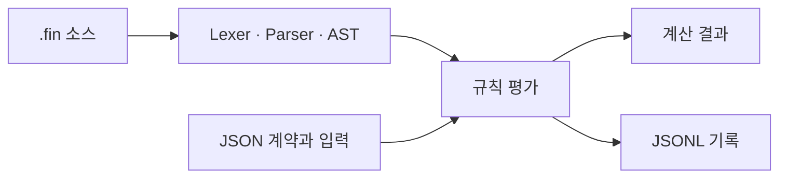

<h1 align="center">finlang</h1>

<p align="center"><strong>십진수로 계산하고 정산 시점을 코드에 남기는 금융 DSL</strong></p>

<p align="center">
  <a href="https://github.com/Pirite08/finlang/releases/tag/v0.5.0"></a>
  
</p>

finlang은 `Decimal`로 정확한 십진수 연산을 하고, `Money`로 금액과 통화를 함께 다룹니다. 이자·수수료·환산 규칙은 정산 위치와 반올림 정책을 명시하고, JSON 계약과 실행 기록으로 결과를 확인할 수 있습니다.

| 시작 방법 | 준비할 것 | 무엇을 해볼 수 있나요? |
| --- | --- | --- |
| **[웹 가이드](https://pirite08.github.io/finlang-guide/)** | 브라우저 | 기초 문법을 순서대로 읽고 예제와 단리 실습 보기 |
| **[Windows x64 체험판](https://github.com/Pirite08/finlang/releases/tag/v0.5.0)** | 저장소 접근 권한 | Go 설치 없이 단리 계산과 감사 재현 실행 |
| **[VS Code 확장](#vs-code-확장)** | VS Code, 저장소 접근 권한 | `.fin` 문법 강조와 변수·함수 자동완성 |
| **[소스에서 실행](#소스에서-실행)** | Go 1.27.3 이상 | CLI로 규칙·JSON 계약·테스트 실행 |

## 빠른 시작

### 첫 번째 계산

원금 **100만 원**에 연이율 **5%**를 **반년** 적용합니다. 아래 코드를 `first-interest.fin`으로 저장하세요.

```text
// 원금에는 통화를 붙이고, 이율과 기간은 십진수로 적습니다.
let principal = money("KRW", 1000000);
let interest = principal * 0.05 * 0.5;

// 계산을 마친 시점에 소수점 0자리로 반올림합니다.
print(settle(interest, 0, "HALF_UP"));
```

체험판 폴더의 PowerShell에서는 `.\fin.exe -file first-interest.fin`, 소스 저장소 루트에서는 `go run ./cmd/fin -file first-interest.fin`으로 실행합니다.

```text
KRW 25000
```

### Windows 체험판

1. [GitHub 릴리스에서 Windows x64 ZIP 받기](https://github.com/Pirite08/finlang/releases/download/v0.5.0/finlang-v0.5.0-windows-amd64.zip)를 눌러 다운로드합니다. 비공개 저장소에 접근할 수 있는 GitHub 계정으로 로그인해야 합니다.
2. ZIP을 쓰기 가능한 폴더에 모두 풀고 `run-demo.cmd`를 두 번 클릭합니다. Go 설치나 API 키가 필요하지 않습니다.
3. 단리 계산과 감사 재현에서 같은 `KRW 25000` 결과를 확인합니다. 실행할 때마다 새 `interest-*.audit.jsonl`이 생깁니다.

VS Code에서도 압축을 푼 폴더를 열고 PowerShell 터미널에서 `.\run-demo.cmd --no-pause`를 실행할 수 있습니다. ZIP에 포함된 계약·입력 JSON을 수정하는 방법은 [체험판 사용 안내](docs/windows-demo.md)에서 확인하세요.

체험판 ZIP을 다시 빌드하려면 Go가 설치된 Windows에서 저장소 루트의 PowerShell을 열고 다음 명령을 실행합니다. ZIP은 `build/`에 생성됩니다.

```powershell
powershell -NoProfile -ExecutionPolicy Bypass -File .\scripts\package-windows-demo.ps1
```

### VS Code 확장

1. 저장소에 접근할 수 있는 GitHub 계정으로 로그인하고 **[finlang Language Support 0.2.0 VSIX 받기](https://github.com/Pirite08/finlang/releases/download/vscode-v0.2.0/finlang-language-0.2.0.vsix)**를 누릅니다.
2. VS Code의 **확장 → `…` → VSIX에서 설치**에서 받은 파일을 선택합니다.
3. `.fin` 파일에서 `set`을 입력하고 **Ctrl+Space**를 누르면 `settle`을 선택할 수 있습니다. 직접 선언한 변수와 함수도 현재 위치에서 쓸 수 있으면 후보에 표시됩니다. 함수를 선택한 뒤 **Tab**으로 인수 자리 사이를 이동합니다.

터미널에서는 VSIX를 받은 폴더에서 아래 명령으로도 설치할 수 있습니다.

```powershell
code --install-extension .\finlang-language-0.2.0.vsix
```

계산은 체험판의 `fin.exe`로 실행합니다. [확장 소스와 상세 안내](editors/vscode/README.md)

### 소스에서 실행

Go 1.27.3 이상이 설치된 환경에서 저장소를 복제한 뒤 루트 디렉터리에서 실행합니다.

```sh
git clone https://github.com/Pirite08/finlang.git
cd finlang
go run ./cmd/fin -version
go run ./cmd/fin -file examples/decimal.fin
```

계약에 맞춰 단리 이자를 계산하고 실행 기록을 남깁니다.

```sh
go run ./cmd/fin -file examples/interest_v1.fin -contract contracts/interest_v1.json -input testdata/inputs/interest.json -json -trace build/interest.trace.jsonl
```

마지막 명령은 원금 `1000000 KRW`, 연이율 `0.05`, 기간 `0.5`로 단리 이자를 계산합니다. 표준 출력에는 다음 JSON 한 건을 기록합니다.

```json
{"schema_version":"1","rule":"interest_v1","status":"ok","result":{"currency":"KRW","amount":"25000"}}
```

실행 파일을 빌드하려면 아래 명령을 사용합니다.

```sh
go build -o build/fin.exe ./cmd/fin
```

Windows PowerShell에서는 `.\build\fin.exe`, macOS·Linux에서는 `go build -o build/fin ./cmd/fin` 후 `./build/fin`으로 실행합니다. `-h`는 사용법, `-version`은 `fin v0.5.0`을 출력합니다.

인수 없이 `go run ./cmd/fin`을 실행하면 한 줄 REPL이 열립니다. 선언한 이름은 다음 줄에도 남습니다. 여러 줄 함수는 UTF-8 파일에 저장한 뒤 `-file`로 실행합니다. 파일에서 값을 출력하려면 `print(...)`를 사용합니다.

## 문서 길잡이

| 관심 있는 내용 | 읽을 곳 |
| --- | --- |
| 문법과 숫자 계산 | [정산 시점](#정산-시점을-코드에-남기기) · [내장 함수](#기초-내장-함수) · [반올림 정책](#십진수와-반올림-정책) |
| JSON 입력과 환산 | [JSON 계약](#json-계약으로-규칙-실행하기) · [절차형 환산](#절차형-환산-규칙) · [고정 환율](#고정-환율로-실행하기) · [실시간 환율](#실시간-환율로-실행하기) · [USD/KRW 수신기](#usdkrw-수신기) |
| 실행 기록과 재현 | [trace](#실제로-실행한-계산-기록하기) · [운영 로그와 감사 기록](#운영-로그와-감사-기록) · [운영용 규칙 모드](#운영용-규칙-모드) |
| 소스와 검증 범위 | [코드 구조](#코드-구조) · [테스트 결과](#검증-재현하기) · [GnuCOBOL 비교](#cobol과-같은-입력으로-비교하기) |

## 정산 시점을 코드에 남기기

`0.335 USD` 세 건을 합산한 뒤 정산하는 경우와, 한 건씩 정산한 뒤 더하는 경우는 결과가 다릅니다.

```text
let item = money("USD", 0.335);

let total = settle(item + item + item, 2, "HALF_EVEN");
print(format_money(total, 2));

let settled_item = settle(item, 2, "HALF_EVEN");
print(format_money(settled_item + settled_item + settled_item, 2));
```

```text
USD 1.00
USD 1.02
```

`money("USD", 0.335)`는 생성할 때 센트 단위로 반올림하지 않습니다. 덧셈과 곱셈도 허용 범위에서 정확한 값을 유지하며, `settle(value, digits, mode)`를 호출한 위치에서 정산합니다. KRW라는 이유로 자동으로 정수 금액을 만들지도 않습니다.

| 연산 | 규칙 |
| --- | --- |
| `Money + Money`, `Money - Money`, 비교 | 같은 통화끼리만 허용 |
| `Money * Decimal`, `Decimal * Money` | 금액에 비율을 곱함 |
| `div(Money, Decimal, digits, mode)` | 나눗셈의 자릿수와 정책을 명시 |
| `settle(Money, digits, mode)` | 지정한 자릿수로 정산 |
| `format_money(Money, digits)` | 통화와 고정 소수 자릿수를 가진 문자열 생성 |

지원 통화는 `KRW`, `USD`입니다. 서로 다른 통화의 덧셈·비교는 `E_CURRENCY_MISMATCH`, 다른 통화 생성은 `E_UNSUPPORTED_CURRENCY`입니다. 통화를 바꾸려면 절차형 규칙에서 `convert`에 환율을 지정합니다. `Money + Decimal`, `Money * Money`도 허용하지 않습니다.

### 숫자와 표시 문자열

숫자는 불필요한 소수부 끝자리 0을 제거합니다. `money("USD", 1.00)`의 숫자 표시는 `USD 1`이며, `format_money(..., 2)`로 표시 문자열 `USD 1.00`을 만듭니다. 끝자리 0은 표시 형식이며 값에 저장된 정산 이력이 아닙니다.

`format_money(money("USD", 1.234), 2)`는 값을 몰래 반올림하지 않고 `E_INEXACT`를 냅니다. 먼저 `settle`로 정책을 적용해야 합니다. Decimal의 `format(x, digits)`도 같은 원칙을 따릅니다.

### 기초 내장 함수

| 함수 | 입력과 결과 | 사용 예시 |
| --- | --- | --- |
| `abs(x)`, `sign(x)` | Decimal 또는 Money를 받습니다. `abs`는 통화를 보존하고 `sign`은 `-1`, `0`, `1` 중 하나를 Decimal로 반환합니다. | `abs(money("USD", -2.35))` → `USD 2.35`<br>`sign(-0.01)` → `-1` |
| `min(a, …)`, `max(a, …)`, `sum(a, …)` | Decimal 또는 같은 통화의 Money를 한 개 이상 받습니다. `sum`은 왼쪽부터 더하며 각 중간 합에 숫자 한도를 적용합니다. | `min(1.2, 3.4)` → `1.2`<br>`max(1.2, 3.4)` → `3.4`<br>`sum(0.1, 0.2)` → `0.3` |
| `clamp(x, lower, upper)` | Decimal끼리 또는 같은 통화의 Money끼리 범위를 적용합니다. 하한이 상한보다 크면 `E_INVALID_RANGE`를 반환합니다. | `clamp(10, 1, 5)` → `5` |
| `floor(x)`, `ceil(x)`, `trunc(x)` | Decimal을 정수값으로 내림·올림·절삭합니다. | `floor(-2.5)` → `-3`<br>`ceil(-2.5)` → `-2`<br>`trunc(-2.5)` → `-2` |
| `decimal(text)`, `amount(m)`, `currency(m)` | `decimal`은 십진 문자열을 읽고, `amount`와 `currency`는 Money에서 각각 Decimal 금액과 통화 문자열을 꺼냅니다. | `decimal("12.30")` → `12.3`<br>`amount(money("USD", 12.30))` → `12.3`<br>`currency(money("USD", 12.30))` → `USD` |

합계와 범위 적용은 정확한 값을 돌려줍니다. 아래 예제는 200만 원의 0.3% 수수료에 최소 100원과 최대 3,000원을 적용한 뒤 `settle`로 원 단위 금액을 확정합니다. `go run ./cmd/fin`으로 REPL을 열어 붙여 넣으면 `KRW 3000`을 출력합니다.

```text
let fee = clamp(money("KRW", 2000000) * decimal("0.003"), money("KRW", 100), money("KRW", 3000));
print(settle(fee, 0, "HALF_EVEN"));
```

운영용 `-rule-only`에서는 `amount(amount)`처럼 함수 호출 위치의 이름과 변수 참조 위치의 이름을 구분합니다. 일반 모드는 변수의 이름을 먼저 찾으므로 이 함수를 호출할 때 `balance` 같은 다른 변수 이름을 사용합니다.

## 십진수와 반올림 정책

`0.1 + 0.2`는 정확히 `0.3`입니다. 정수와 `12.34` 형태의 소수 리터럴을 지원하고, 음수는 `-` 접두 연산자로 표현합니다. 지수 표기, `NaN`, `Infinity`, 숫자 구분용 쉼표·밑줄과 문자열의 자동 숫자 변환은 지원하지 않습니다.

나눗셈은 `div(a, b, digits, mode)`를 사용합니다. `/`는 정책을 생략할 수 없도록 `E_DIVISION_POLICY_REQUIRED`를 냅니다. Decimal에는 `round`, Money에는 `settle`을 사용합니다.

| 모드 | 처리 규칙 | `round(-2.5, 0, mode)` |
| --- | --- | --- |
| `HALF_EVEN` | 가장 가까운 값, 정확히 중간이면 마지막 숫자가 짝수인 쪽 | `-2` |
| `HALF_UP` | 가장 가까운 값, 정확히 중간이면 절댓값이 커지는 쪽 | `-3` |
| `TOWARD_ZERO` | 0을 향해 절사 | `-2` |
| `EXACT` | 0이 아닌 자리를 버려야 하면 `E_INEXACT`로 거부 | 오류 |

```text
print(div(1, 3, 6, "HALF_EVEN"));
print(round(2.345, 2, "HALF_EVEN"));
print(format(round(9.995, 2, "HALF_EVEN"), 2));
```

결과는 `0.333333`, `2.34`, `10.00`입니다. `EXACT`는 더 정밀한 근삿값을 만드는 모드가 아니라, 지정한 자릿수에서 값 손실을 허용하지 않는 모드입니다.

## JSON 계약으로 규칙 실행하기

소스는 계산식을, 계약은 진입 함수와 입출력 조건을 정의합니다. 계약은 매개변수의 순서·타입·통화·범위·최대 소수 자릿수와 출력의 통화·범위·소수 자릿수를 검사합니다.

[이자 규칙](examples/interest_v1.fin):

```text
let main = fn(principal, annual_rate, years) {
    return settle(principal * annual_rate * years, 0, "HALF_UP");
};
```

[입력](testdata/inputs/interest.json):

```json
{
  "schema_version": "1",
  "rule": "interest_v1",
  "inputs": {
    "principal": {"currency": "KRW", "amount": "1000000"},
    "annual_rate": "0.05",
    "years": "0.5"
  }
}
```

금액·비율·기간과 계약의 `min`·`max`는 모두 **JSON 문자열**입니다. JSON 숫자로 읽으면서 정밀도를 잃지 않도록 `"0.05"`처럼 전달합니다. 계약 메타데이터의 `scale`, `scale_max`는 정수입니다. 입력의 `scale_max`는 끝자리 0을 제거하기 전 원문 소수 자릿수에도 적용됩니다.

출력 `amount`는 계약의 `scale`에 맞춘 문자열입니다. 출력 인코더가 정산을 대신하지 않습니다. 예를 들어 출력 `scale: 2`에 `1.005`를 반환하면 `E_OUTPUT_SCALE`로 거부합니다. 필요한 정산은 소스에서 명시해야 합니다. JSON 결과 모드에서 `print`는 `E_OUTPUT_SIDE_EFFECT`로 거부됩니다.

| 규칙 | 소스 / 계약 / 입력 | 포함된 입력의 결과 |
| --- | --- | --- |
| `interest_v1` | [소스](examples/interest_v1.fin) · [계약](contracts/interest_v1.json) · [입력](testdata/inputs/interest.json) | `KRW 25000` |
| `sum_v1` | [소스](examples/sum_v1.fin) · [계약](contracts/sum_v1.json) · [입력](testdata/inputs/sum.json) | `USD 1.00` |
| `fee_v1` | [소스](examples/fee_v1.fin) · [계약](contracts/fee_v1.json) · [입력](testdata/inputs/fee.json) | `KRW 1500` |

다른 규칙을 실행하려면 빠른 시작 명령의 소스·계약·입력 파일을 해당 행의 파일로 바꿉니다. `-file`, `-contract`, `-input`, `-json`을 함께 사용하고, trace가 필요할 때 `-trace`를 추가합니다.

## 절차형 환산 규칙

USD를 KRW로 환산하는 규칙은 입력과 출력의 통화를 먼저 선언하고, 검사·조회·환산·정산 순서를 `step`으로 표현합니다. [예제 소스](examples/usd_to_krw.fin)

```text
rule usd_to_krw {
    input amount in "USD"
    output result in "KRW"

    step check_amount {
        require amount > money("USD", 0)
    }

    step get_rate {
        let quote = rate("USD", "KRW")
    }

    step convert_amount {
        let converted = convert(amount, quote)
    }

    step settle_amount {
        let result = settle(converted, 0, "HALF_EVEN")
    }

    return result
}
```

`rule`은 금액 입력 하나와 금액 출력 하나를 선언합니다. `step`은 적힌 순서대로 실행되며, 단계 본문에 바로 선언한 `let` 값은 뒤 단계에서 읽을 수 있습니다. `require`는 Bool을 검사하고 `false`이면 그 위치에서 실행을 끝냅니다. 마지막 `return`에는 선언한 출력 이름을 씁니다.

JSON 계약의 `entry`는 `rule` 이름과 같아야 하며, 입력 이름·통화와 출력 통화도 소스 선언과 일치해야 합니다. 계약은 금액 범위와 자릿수를 정합니다. `convert`는 정확한 소수로 환산하고 `settle`은 따로 원 단위 `HALF_EVEN`을 적용합니다. [JSON 계약](contracts/usd_to_krw.json) · [USD 10 입력](testdata/inputs/usd_to_krw.json)

### 고정 환율로 실행하기

```sh
go run ./cmd/fin -file examples/usd_to_krw.fin -contract contracts/usd_to_krw.json -input testdata/inputs/usd_to_krw.json -json -fx-fixed testdata/fx/usd_to_krw.json -trace build/usd_to_krw.trace.jsonl
```

USD 10에 고정 환율 `1350.25`를 곱하면 KRW 13502.5이고, 원 단위 정산 결과는 KRW 13502입니다. 환율 파일에는 방향(`base`, `target`), 십진 문자열 `rate`, 출처 `source`, 기준 시각 `as_of`가 들어 있습니다. [고정 환율 파일](testdata/fx/usd_to_krw.json)

```json
{"schema_version":"1","rule":"usd_to_krw","status":"ok","result":{"currency":"KRW","amount":"13502"}}
```

### 실시간 환율로 실행하기

Alpha Vantage를 사용하려면 실행할 셸의 `FINLANG_ALPHA_VANTAGE_API_KEY` 환경 변수에 API 키를 설정합니다. [Alpha Vantage 환율 API](https://www.alphavantage.co/documentation/#currency-exchange)

```sh
go run ./cmd/fin -file examples/usd_to_krw.fin -contract contracts/usd_to_krw.json -input testdata/inputs/usd_to_krw.json -json -fx-provider alpha-vantage -trace build/usd_to_krw-live.trace.jsonl
```

직접 운영하는 공급처는 `-fx-url`로 지정할 수 있습니다. 아래 예시의 URL을 공급처 주소로 바꾸면 `GET` 요청에 `base=USD`와 `target=KRW`가 붙습니다. 응답은 고정 환율 파일과 같은 JSON 형식이며 `as_of`는 해당 환율의 실제 기준 시각입니다. 일반 공급처 주소는 HTTPS를 사용하며, 루프백 어댑터는 HTTP도 사용할 수 있습니다.

```sh
go run ./cmd/fin -file examples/usd_to_krw.fin -contract contracts/usd_to_krw.json -input testdata/inputs/usd_to_krw.json -json -fx-url https://quotes.example.net/latest -trace build/usd_to_krw-live.trace.jsonl
```

`-fx-fixed`, `-fx-provider`, `-fx-url` 중 하나를 선택합니다. 실시간 모드에서는 `rate`를 처음 호출할 때 해당 방향의 환율을 한 번 조회하고, 같은 실행 안에서 같은 방향을 다시 요청하면 그 값을 사용합니다. 다음 실행에서는 다시 조회합니다. 기준 시각이 기본 5분보다 오래됐거나 미래이면 오류를 반환합니다. 허용 경과 시간은 `-fx-max-age`로 조정합니다.

실시간 환율의 기본 허용 범위는 1 USD당 500~3,000 KRW이며 양 끝을 포함합니다. 기관별 범위는 `-fx-min-rate`와 `-fx-max-rate`에 십진수로 지정합니다. KRW→USD 방향도 같은 USD 기준 범위를 적용합니다. 범위를 벗어난 응답은 `E_FX_OUTLIER`로 실행을 중단합니다. 고정 환율 파일을 사용한 재현에는 기존 입력 검사를 적용합니다.

`-trace`를 지정하면 헤더의 `fx_quotes`에 적용 환율·방향·출처·기준 시각을 저장하고, `step_start`·`binding`·`step_end`에 실제 단계와 중간 값을 기록합니다. 한도에 도달해 이벤트가 잘려도 사용한 환율은 헤더에 남습니다. 환율 한 건을 재현하려면 헤더의 해당 객체를 JSON 파일로 저장해 `-fx-fixed`로 실행합니다.

### USD/KRW 수신기

`fxfeed`는 Twelve Data에서 USD/KRW 시세를 구독하고, 받아둔 최신 시세 한 건을 로컬 HTTP로 제공합니다. USD/KRW WebSocket에 접근할 수 있는 키를 첫 번째 터미널의 `FINLANG_TWELVE_DATA_API_KEY` 환경 변수에 설정합니다. [WebSocket 구독 문서](https://twelvedata.com/docs/websocket/websocket-getting-started)

첫 번째 터미널에서 수신기를 실행합니다.

```sh
go run ./cmd/fxfeed -listen 127.0.0.1:8080
```

두 번째 터미널에서 이 주소를 `-fx-url`에 지정합니다.

```sh
go run ./cmd/fin -file examples/usd_to_krw.fin -contract contracts/usd_to_krw.json -input testdata/inputs/usd_to_krw.json -json -fx-url http://127.0.0.1:8080/latest -trace build/usd_to_krw-stream.trace.jsonl
```

첫 시세를 기다리는 동안에는 `/latest`가 HTTP 503을 반환합니다. 응답하는 환율의 기준 시각과 출처는 실행 기록의 `fx_quotes`에 남습니다. 새 시세는 다음 환산 실행에서 반영됩니다. 같은 실행에서 `rate("USD", "KRW")`를 다시 호출하면 처음 읽은 값을 사용합니다.

수신기가 연결을 다시 맺는 동안에도 보관한 시세가 허용 나이 안에 있으면 제공됩니다. 기본 허용 나이는 5분이며, 수신기의 `-max-age`와 finlang의 `-fx-max-age`를 각각 조정할 수 있습니다. 허용 나이는 조회 주기와 별개입니다. Twelve Data의 Forex v2 문서는 WebSocket 중간 환율이 분 단위로 갱신된다고 안내합니다. [Twelve Data Forex v2](https://support.twelvedata.com/en/articles/12520817-forex-api-v2)

수신기는 중복 필드가 있거나 인식하는 필드의 대소문자가 올바르지 않은 WebSocket 메시지를 버립니다. 범위 밖 시세도 버리고, 이전 정상 시세는 유효 시간이 끝날 때까지 제공합니다. 범위를 조정할 때는 수신기의 `-min-rate`, `-max-rate`와 finlang의 `-fx-min-rate`, `-fx-max-rate`를 함께 설정합니다.

로컬 WebSocket부터 `-fx-url`을 사용하는 finlang까지 연결한 테스트는 다음 명령으로 재현합니다.

```sh
go test ./internal/fxstream -run '^TestStreamUpdatesNextFinlangRun$' -count=1 -v
```

테스트는 첫 환산이 진행되는 중 로컬 WebSocket에서 환율을 `1350.25`에서 `1350.35`로 갱신합니다. USD 10을 환산한 첫 실행은 KRW 13502를, 다음 실행은 KRW 13504를 반환합니다. 두 실행의 trace에서 각 환율을 확인했습니다. 실제 Twelve Data 계정의 구독을 확인하려면 키가 필요합니다.

## 실제로 실행한 계산 기록하기

`-trace build/interest.trace.jsonl`은 실제 평가 중 발생한 연산·함수 호출·분기·정산 등을 한 줄에 하나의 JSON 레코드로 기록합니다. 소스를 분석해 예상 경로를 만들어 낸 기록이 아닙니다.

| 레코드 | 내용 |
| --- | --- |
| `header` | 소스 SHA-256, 계약·실행기 버전, 입력, 실행 한도, 사용한 환율 |
| `event` | 순번, 소스 위치, 입력·결과, 해당되는 경우 통화·목표 자릿수·모드·분기·단계 |
| `summary` | 기록한 이벤트 수와 `trace_truncated` |

`inexact: true`는 해당 정산·나눗셈에서 0이 아닌 자리를 버렸다는 뜻입니다. 기본 기록 한도는 **10,000개 이벤트**입니다. 한도를 넘으면 추가 이벤트를 버리고 `trace_truncated: true`를 남기며, 계산 자체는 계속합니다. 따라서 잘린 trace는 전체 실행 기록으로 해석하면 안 됩니다.

소스·입력·계약·실행 설정과 사용한 환율이 같으면 같은 기록을 생성하도록 설계했습니다. trace는 입력과 중간 금액을 포함하므로 공유할 때 그 내용도 함께 확인해야 합니다.

### 운영 로그와 감사 기록

`-ops-log`는 파일 실행이 끝나면 실행 ID, UTC 시각, 성공·실패 상태, 종료 코드와 오류 코드만 JSONL 한 줄로 추가합니다. 운영 로그 수집기는 이 파일을 읽습니다. 표준 출력과 표준 오류는 호출자에게 반환하는 거래 결과와 진단에 사용합니다.

`-audit`는 JSON 계약 실행용입니다. 새 파일에 운영 로그와 연결되는 실행 ID, 규칙명과 소스 SHA-256, 계약 스키마 버전과 파일 SHA-256, 실행기가 적용한 환율 정책 버전·설정, 실제 사용한 환율·출처·시각, 입력과 결과를 기록합니다. 이 파일에는 거래 금액과 중간값이 있으므로 접근 권한이 제한된 디렉터리에 보관합니다. Windows에서는 해당 디렉터리의 ACL로 열람 권한을 제한합니다.

```sh
go run ./cmd/fin -file examples/usd_to_krw.fin -contract contracts/usd_to_krw.json -input testdata/inputs/usd_to_krw.json -json -fx-fixed testdata/fx/usd_to_krw.json -ops-log build/operations.jsonl -audit build/usd_to_krw.audit.jsonl
go run ./cmd/fin -file examples/usd_to_krw.fin -contract contracts/usd_to_krw.json -json -replay-audit build/usd_to_krw.audit.jsonl -ops-log build/operations.jsonl
```

재현은 성공한 감사 기록의 입력과 환율을 사용합니다. 규칙·계약의 SHA-256과 버전이 맞아야 하며, 계산 결과가 기록과 같을 때만 결과를 반환합니다. SHA-256은 규칙과 계약 파일의 변경을 확인하는 데 쓰입니다. 감사 파일 자체의 무결성은 보관 시스템의 접근 제어와 변경 이력으로 관리해야 합니다.

`-audit`로 다시 실행할 때는 새 파일 경로를 지정합니다. `-replay-audit`는 이미 만든 감사 파일을 읽습니다.

### 운영용 규칙 모드

JSON 계약 실행에 `-rule-only`를 추가하면 첫 `step` 전에 모든 단계와 `if` 분기를 검사합니다. 단계에서는 `let`, `require`, `if`와 허용된 식을 사용합니다. `round`, `div`, `format`, `money`, `settle`, `format_money`, `rate`, `convert`와 [기초 내장 함수](#기초-내장-함수)를 이름으로 직접 호출할 수 있습니다. `fn`, 함수 값을 통한 호출, `print`는 실행되지 않는 분기에 있어도 `E_RULE_POLICY`로 거부합니다.

```sh
go run ./cmd/fin -file examples/usd_to_krw.fin -contract contracts/usd_to_krw.json -input testdata/inputs/usd_to_krw.json -json -rule-only -fx-fixed testdata/fx/usd_to_krw.json -audit build/rule-only.audit.jsonl
go run ./cmd/fin -file examples/usd_to_krw.fin -contract contracts/usd_to_krw.json -json -replay-audit build/rule-only.audit.jsonl
```

`rate()`는 실행 전에 읽고 검증한 환율만 메모리에서 조회합니다. 한 방향은 `-fx-fixed`, 두 방향은 같은 환율 객체를 JSON 배열에 담아 `-fx-snapshot`으로 전달합니다. 환율 형식, 방향, 중복, 정밀도를 검사하며, 거래에 사용할 시세의 승인과 신선도 판단은 스냅샷을 준비할 때 처리합니다. `-fx-url`과 `-fx-provider`는 운영용 모드에서 거부합니다. 운영용 감사 기록을 재현할 때는 기록된 `rule-only-v1` 프로필이 자동으로 적용됩니다.

#### 여러 입력으로 단리 이자 계산하기

`rule`은 `input principal in "KRW"`처럼 통화를 지정한 Money 입력과 `input annual_rate as decimal`처럼 Decimal 입력을 여러 개 선언할 수 있습니다. 각 입력은 선언 순서와 상관없이 같은 이름의 JSON 계약 항목에 연결됩니다. 계약에서 자료형, 통화, 범위, 소수 자릿수를 검사합니다.

[운영용 단리 규칙](examples/interest_rule_v1.fin)은 기존 입력으로 원금 100만 원, 연이율 `0.05`, 기간 `0.5`년을 받아 `KRW 25000`을 반환합니다. 아래 두 실행은 같은 JSON 결과를 냅니다.

```sh
go run ./cmd/fin -file examples/interest_rule_v1.fin -contract contracts/interest_rule_v1.json -input testdata/inputs/interest.json -json -rule-only -audit build/interest-rule.audit.jsonl
go run ./cmd/fin -file examples/interest_rule_v1.fin -contract contracts/interest_rule_v1.json -json -replay-audit build/interest-rule.audit.jsonl
```

## 언어 범위와 실행 한도

`let`, Decimal·Money·Bool·String, 비교, `if`·`else`, `fn`·`return`, 어휘적 스코프·클로저·재귀를 지원합니다. `if` 조건은 Bool만 허용합니다. 같은 환경에서 이름을 다시 선언할 수 없고 함수는 `return`으로 값을 반환해야 합니다. 세미콜론은 문장 사이에 쓰며 파일 끝과 닫는 중괄호 직전에는 생략할 수 있습니다.

| 항목 | 기본 한도 |
| --- | ---: |
| 정규화한 십진 계수 | 128자리 |
| 소수 스케일 및 자리 인수 | 36 |
| 토큰 | 256바이트 |
| 파일 소스·REPL 한 줄 | 1 MiB |
| 구문 중첩 | 128 |
| 평가 노드 실행 | 100,000 |
| 함수 호출 깊이 | 64 |
| trace 이벤트 | 10,000 |

한도를 넘으면 오류로 알립니다. 진단은 가능한 경우 파일명·행·열·오류 코드를 포함합니다. CLI 종료 코드는 성공 `0`, 소스·계산·계약 오류 `1`, 사용법·파일 입출력 오류 `2`입니다. REPL은 개별 계산 오류 후 다음 줄을 읽으며 실행 한도는 줄마다 초기화합니다.

자동 형 변환, 문자열 연결, 논리 AND·OR, 배분 연산, JIT, COBOL 실행·호환 계층은 현재 제공하지 않습니다.

## 코드 구조



`fin` 인터프리터는 Go 표준 라이브러리로 구현합니다. 실시간 시세 수신기는 별도 실행 파일인 `fxfeed`에 있습니다.

| 경로 | 역할 |
| --- | --- |
| [`cmd/fin`](cmd/fin), [`internal/cli`](internal/cli) | 실행 진입점과 CLI |
| [`internal/decimal`](internal/decimal) | 십진 표현·정확한 연산·반올림·표시 |
| [`internal/money`](internal/money) | 통화 검사와 명시적 정산 |
| [`internal/fx`](internal/fx) | 고정·HTTP 환율과 Alpha Vantage 응답 검증 |
| [`cmd/fxfeed`](cmd/fxfeed), [`internal/fxfeed`](internal/fxfeed), [`internal/fxstream`](internal/fxstream) | Twelve Data 구독과 로컬 USD/KRW 환율 제공 |
| [`internal/lexer`](internal/lexer), [`internal/parser`](internal/parser), [`internal/ast`](internal/ast) | 토큰·문법·구문 트리 |
| [`internal/eval`](internal/eval), [`internal/repl`](internal/repl) | 평가·내장 함수·대화형 실행 |
| [`internal/contract`](internal/contract) | JSON 계약과 입력·출력 검증 |
| [`internal/trace`](internal/trace) | 제한된 결정적 이벤트 기록과 JSONL 직렬화 |
| [`internal/opslog`](internal/opslog) | 실행 ID와 상태 코드 중심의 운영 로그 |
| [`internal/config`](internal/config), [`internal/diagnostic`](internal/diagnostic) | 실행 한도와 위치 기반 오류 |
| [`examples`](examples), [`contracts`](contracts), [`testdata`](testdata) | 실행 예제·계약·검증 입력 |

## 검증 재현하기

### v0.5.0 검증 결과

Windows/amd64에서 Go 1.27.3과 GnuCOBOL 3.2.0으로 실행했습니다.

| 검증 | 결과 |
| --- | --- |
| 전체 Go 테스트 | 최상위 174개, 하위 사례 포함 716개 통과. 테스트 사례 실패·건너뜀 0개 |
| Windows 체험판 | Go가 `PATH`에 없는 상태에서 압축을 풀어 실행. 단리 계산과 감사 재현의 JSON이 예상 결과 `KRW 25000`과 일치. 입력 파일을 제거한 뒤에도 감사 재현 성공 |
| 기초 내장 함수 | 정확한 Decimal 합계, 음수 내림·올림·절삭, 같은 통화의 Money 처리, 혼합 통화·빈 합계·뒤집힌 범위·숫자 한도 오류 확인 |
| 운영용 규칙 모드 | 실행 전 함수 값 호출과 `print` 차단, 검증된 환율 스냅샷으로 계산 |
| 감사 재현 | 환율 공급자를 종료한 뒤에도 저장된 환율로 동일 결과 재현. 내장 함수 수수료 예제는 상한 적용 후 `HALF_EVEN` 정산과 동일한 JSON 결과 확인 |
| GnuCOBOL 회귀 비교 | 이자·수수료·합산 3,072건 실행 및 일치. 계약 입력 거절 40건은 별도 집계 |
| 정적 검사·동시성 검사·빌드 | `go vet ./...`, CLI·평가기·Decimal의 `-race` 테스트, `fin`·`fxfeed` 빌드 통과 |

```sh
go test ./internal/eval ./internal/cli -run 'TestBasicBuiltin|TestRuleOnly|TestOperationalLogAndAuditReplay' -count=1 -v
```

### v0.4.0 검증 결과

| 검증 | 결과 |
| --- | --- |
| 전체 Go 테스트 | 최상위 127개, 하위 사례 포함 547개 통과, 건너뜀 0개 |
| GnuCOBOL 회귀 비교 | 이자·수수료·합산 3,072건 실행, 3,072건 일치, 계약 입력 거절 40건 별도 집계 |
| 고정 환율 | 단계 순서와 환산·정산 값, 출처·기준 시각 기록 확인 |
| HTTP 환율 | 응답을 바꾸는 로컬 HTTP 서버로 실행 내 재사용·다음 실행 재조회 확인 |
| Alpha Vantage | 어댑터는 테스트 응답으로 검증. 실제 계정 호출은 API 키 미설정으로 미실행 |
| 정적 검사·빌드 | `go vet ./...`와 실행 파일 빌드 통과 |

환산 규칙과 공급처 테스트를 따로 실행할 수 있습니다.

```sh
go test ./internal/cli ./internal/fx -run 'TestRule|TestHTTPProvider|TestAlphaVantage' -count=1 -v
```

COBOL 비교를 포함한 전체 결과를 재현하려면 GnuCOBOL과 C 도구 체인을 준비하고 `FINLANG_REQUIRE_COBOL=1`을 설정한 뒤 `go test -count=1 ./...`를 실행합니다. [COBOL 비교 설정](#cobol과-같은-입력으로-비교하기)

### 기존 버전 검증

```sh
go test -count=1 ./...
go vet ./...
go test ./internal/eval -run TestMoneySettlementTiming -v
go test ./internal/contract ./internal/trace -v
```

v0.1 기준 검증에서는 소수 입력 10,000쌍을 `math/big.Rat`과 비교하고, 반올림·나눗셈 12,041건을 독립 기준과 대조했습니다. 이는 **v0.1 숫자 연산 검증**이며 v0.2 전체의 테스트 건수를 뜻하지 않습니다.

v0.2에서도 이 숫자 회귀 검증을 다시 통과했습니다. 당시 통합 검증은 최상위 테스트·퍼즈 함수 **96개**, 하위 사례 포함 **319개**가 통과했으며, 빌드한 실행 파일로 예제와 오류 경로 **18개**를 확인했습니다.

- [v0.1 검증 범위와 결과](docs/evaluation/v0.1-verification.md)
- [v0.2 검증 범위와 결과](docs/evaluation/v0.2-verification.md)
- [v0.3 통합 검증](docs/evaluation/v0.3-verification.md): 최상위 108개, 하위 사례 포함 491개 통과; COBOL 비교 건너뜀 없음
- [설계 선택과 제약](docs/evaluation/design-decisions.md)

표현 방식 실험은 `go test ./experiments -run TestRepresentationProbe -v`와 `go test ./experiments -bench BenchmarkRepresentationProbe -benchmem`으로 재현할 수 있습니다. 파싱·메모리 할당 포함 조건이 달라, 이 측정만으로 인터프리터 전체나 특정 숫자 표현의 속도 우위를 판단하지 않습니다.

## COBOL과 같은 입력으로 비교하기

v0.3에서는 직접 작성한 교육용 COBOL 프로그램과 기존 finlang의 **이자·수수료·합산 규칙**을 실제로 실행해 비교했습니다. Windows/amd64의 GnuCOBOL 3.2.0에서 다음 결과를 확인했습니다.

| 규칙 | 실제 양쪽 실행 | 일치 | 불일치 | 같은 수신 범위 오류 |
| --- | ---: | ---: | ---: | ---: |
| 이자 | 1,024 | 1,024 | 0 | 414 |
| 수수료 | 1,024 | 1,024 | 0 | 0 |
| 합산 | 1,024 | 1,024 | 0 | 343 |
| 합계 | **3,072** | **3,072** | **0** | **757** |

정상 금액 2,315건과 예상 범위 오류 757건이 일치했습니다. 독립적으로 계산한 기준값 54개도 양쪽이 통과했습니다. 잘못된 통화·자리·범위·JSON 등 계약 입력 거절 40건은 COBOL로 보내지 않고 별도로 확인했습니다.

수수료 경계 `999999.99 / 1000000 / 1000000.01`은 정산 금액이 모두 `1000`이어도 실제 분기가 `low / low / high`인지 확인합니다. 합산은 양수·음수의 HALF_EVEN 중간값, 상쇄, 음의 0, 최종 필드 초과를 확인합니다. 단리의 14자리 중간 소수도 보존합니다.

COBOL에도 십진수와 반올림 기능이 있습니다. 비교에서는 PACKED-DECIMAL 필드와 반올림을 명시했으며, HALF_UP에는 `NEAREST-AWAY-FROM-ZERO`, HALF_EVEN에는 `NEAREST-EVEN`을 사용했습니다. 엄격한 표준 모드의 별칭·예약어 차이는 [고정 프로필](testdata/cobol/profile.md)에 기록했습니다. 결과를 맞추려고 수식이나 필드 범위를 바꾸지 않았습니다.

GnuCOBOL과 C 도구 체인이 준비된 PowerShell에서:

```powershell
New-Item -ItemType Directory -Force build | Out-Null
$env:FINLANG_REQUIRE_COBOL = '1'
$env:FINLANG_COMPAT_REPORT = Join-Path (Get-Location) 'build/compatibility.jsonl'
go test ./tests/compat -run TestCOBOL -count=1 -v
```

`COBC`로 컴파일러 경로를 지정할 수 있습니다. 도구가 없으면 일반 테스트는 비교를 건너뛰므로, 실제 비교 확인에는 위처럼 `FINLANG_REQUIRE_COBOL=1`을 사용합니다.

- [비교 결과·경계 사례·환경·재현 방법](docs/evaluation/compatibility.md)
- [입력과 양쪽 결과, 명령과 소스 해시를 담은 전체 JSONL](docs/evaluation/v0.3-compatibility.jsonl)
- [표현 방식별 성능 측정과 원자료](docs/evaluation/performance.md)
- [사용 과제 평가 계획과 빈 기록지](docs/evaluation/usability.md)

이 결과는 **명시한 프로필과 입력 집합**에 한정됩니다. IBM Enterprise COBOL이나 은행 시스템 전체의 호환성을 뜻하지 않습니다. 실제 참가자 사용성 평가는 미실행이며, 이번 덧셈 실험에서는 실험용 문자열 구현이 현재 스케일드 정수 구현보다 빨랐습니다. 따라서 접근성·속도 우위를 검증했다고 주장하지 않습니다.

## 다음 단계

| 버전 | 범위 |
| --- | --- |
| v0.1 | Decimal과 언어·파일 실행·REPL 기반 |
| v0.2 | Money, 명시적 정산, JSON 계약 실행, 실제 실행 trace |
| v0.3 | 교육용 COBOL 3개 규칙의 실제 차등 비교, 경계·오류 검증과 재현 자료 |
| v0.4 | 순서가 명시된 `rule`·`step`, 실행마다 조회하는 환율과 실행 내 고정, 환율·단계 기록 |
| v0.5 | USD/KRW WebSocket 수신기, 운영용 규칙 모드, 운영 로그와 감사 재현, 기초 내장 함수 12개 |
| 남은 평가 | 실제 참가자 사용성 평가, 실제 업무 규칙 및 다른 COBOL 환경의 별도 검증 |

작은 계산 규칙을 옮길 때 입력·중간 필드·정산 시점·예외가 보존되는지 확인하는 단계입니다. 운영 시스템의 교체는 후속 검증 범위입니다.
